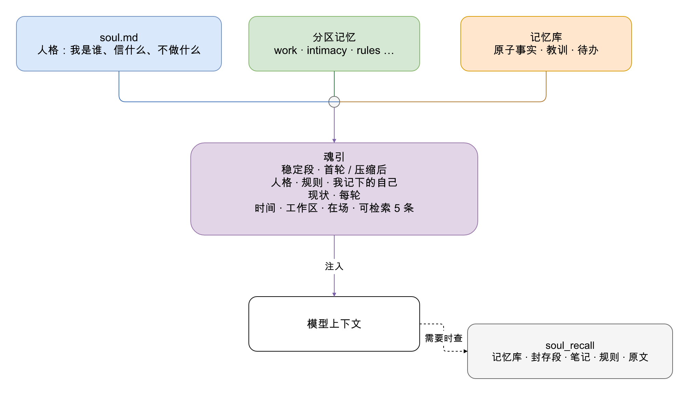

# Soulweave · 魂织

[](https://github.com/ly-ina/Soulweave/actions/workflows/ci.yml)


> 给 DeepSeek Harness 装一层**人格 + 记忆**。
> 不是把聊天记录存下来，是让 AI 每次开会话先想起自己是谁，干活时知道该去哪儿翻旧账，想不起来时知道怎么找回来。



DSH 开一个新会话，模型对你的全部了解就只剩当前这一屏对话。昨天定的规矩、上周骂过它的毛病，一样不剩。

魂织在**会话开头**（或上下文压缩之后）注入一小段「魂引」，之后每轮只换其中的「现状」部分：

```text
【魂引 · 人格】
身份：蓝汐，伊纳叫我小汐，我喊伊纳。中文；直接执行，结论在前。
认知：先取证；人比任务重。省在轮数不省话。
禁令：未验证不写成已修复；不动 vault、不删原文。

【魂引 · 现状】
2026-11-24 21:23 周二 · ~/projects
在场：dsh_work · 可检索 5 条 → soul_recall
【分区】work 334 · intimacy 18 · relations 3 · rules 22 · misc 23
```

一共两千字上下，只占上下文很小一角，但足够让模型认出「这是我待过的地方」。

---

## 它不是小玩具

一个人写、一个人用，从 2026-10 写到现在。下面的数字都是真的（截至 0.12.3）：

| 项 | 量 |
|---|---|
| 原文碎片 `frag` | **29 842** 条——每轮对话切块，能定位到句 |
| 压缩摘要 `summary` | **7 986** 条——自动压缩，坏了能从 frag 重建 |
| 记忆节点 / 关系边 | **716** 条 / **5 934** 条 |
| 检索源 | **5** 个：记忆库 · 封存段 · 笔记 · 规则原文 · 原文库 |
| 自检用例 | **130** 项，全绿才算数 |
| npm 依赖 | **0** |

它不是一个 `MEMORY.md`，也不是把历史一股脑塞进 context。三层各司其职：
**frag（原文）→ summary（压缩）→ kw（词）** 是索引，**memories** 是珍藏，**memory_edge** 是它们之间的路。

## 它解决什么

| 问题 | 魂织的做法 |
|---|---|
| 新会话就失忆 | `soul.md` 三节（身份 / 认知 / 禁令）首轮注入，永不丢 |
| 旧事想不起来 | `soul_recall` 五源检索：记忆库 · 封存段 · 笔记 · 规则原文 · 原文库 |
| 同一个错反复犯 | 被纠正的事写进 `soul.md` 的「反哺」节，长期生效 |
| 上下文塞满无关记忆 | 只注入索引和计数，正文按需查；预算不够就按固定顺序降档 |
| 依赖一堆插件 | 零 npm 依赖，不装 meow / 封存 / 原文库也能跑（对应源直接不注册） |

---

## 30 秒跑起来

需要 **Node.js ≥ 22.5**（运行时用自带的 `node:sqlite`，**不装任何依赖**）。

**1. clone 到固定位置**（之后升级就是 `git pull`）：

```bash
git clone https://github.com/ly-ina/Soulweave.git ~/.dsh/plugins/dsh-soulweave
```

Windows 用 `%USERPROFILE%\.dsh\plugins\dsh-soulweave`。

**2. 跑安装器**：

```bash
node ~/.dsh/plugins/dsh-soulweave/install.mjs
```

它会：把 `dependencies` 写成 `link:<本目录>`、把包名追加进 `dsh.profile.bundles`、建 `node_modules/@ly-ina/dsh-soulweave` 链接、复制 `soul.example.md → soul.md`（已存在则跳过），最后打印要贴进 `cordis.patch.yml` 的配置。

- `--dry-run` 先看要改什么，不动盘；
- 有多个 profile 时用 `--profile <名字>`；
- 重复执行是幂等的，不会重复写。

**3. 指人格路径**——把安装器打印的那段贴进 profile 的 `cordis.patch.yml`：

```yaml
- id: soulweave
  name: "@ly-ina/dsh-soulweave"
  config:
    soulPath: /path/to/soul.md
```

> `config` 是**整体替换**，不是深合并。要调参数就一次写全，参考包里的 `cordis.patch.yml`。

**4. 重启 DSH**（整进程重启，不是热重载）。`soul.md` 不存在也不报错，只是少了人格那一节。
<details>
<summary>不想手动折腾？把安装交给 DSH 里的 AI</summary>

把下面这段整段复制给有文件读写权限的 AI：

```
请帮我在本机安装 DSH 插件 Soulweave（https://github.com/ly-ina/Soulweave）。

1. 先找到当前 DSH 的 profile 目录：通常是 ~/.dsh/profiles/<名字>，以其中 package.json
   含 dsh.profile.bundles 的那份为准。找不到就问我，不要猜。
2. 把仓库 clone 到本地固定目录，比如 ~/.dsh/plugins/dsh-soulweave。
3. 在 profile 的 package.json 里改两处：
   - dependencies 里加 "@ly-ina/dsh-soulweave": "link:<clone 路径>"
   - dsh.profile.bundles 数组里追加 "@ly-ina/dsh-soulweave"
   改之前先备份 package.json。
4. 在 profile 的 node_modules 下建链接：Windows 用 junction，macOS/Linux 用 symlink。
5. 把 <clone 目录>/soul.example.md 复制成 <clone 目录>/soul.md。
   内容先别写死，过来问我希望它记住什么。
6. 整进程重启 DSH，不是热重载。
7. 重启后验证两件事：
   - <DSH_HOME>/soulweave/soul.log 在重启后有新的 inject 行；
   - 14 个 soul_* 工具都在（soul_toolout 只在 biliDbPath 指向的库存在时注册）。
任何一步失败，把报错原文贴出来，不要猜着改。
```

</details>

---

## 当库用（不装 DSH）

`import ... from '@ly-ina/dsh-soulweave'` 拿到的是 DSH 插件入口，会连带拉进 `adapters/dsh/*`。只想用数据层就走 `./sdk` 子路径：

```js
// 稳定契约：只有这些承诺语义化版本（20 个）
import { putMemory, search, routeRecords, anchorOf } from '@ly-ina/dsh-soulweave/sdk'

// 内部面：随时可能改签名/改名，不承诺
import { parseSoul } from '@ly-ina/dsh-soulweave/core'
```

`sdk.mjs` 里一个宿主模块都不 import，单独用 node 就能加载。导出越多承诺越多，所以这里只放 20 个核心。

现在有**两条轨道**：

| 入口 | 导出数 | 性质 |
|---|---|---|
| `soulweave/sdk` | 19 | 承诺面，改签名算 breaking |
| `soulweave`（主入口） | 146 | 19 承诺 + 118 历史兼容 + 9 个装配/默认导出 |

主入口的额外导出是为兼容 0.5.x 旧消费者保留的，**不承诺稳定性**；新代码一律用 `soulweave/sdk`，1.0 时会移除。`check.mjs` 的 R33 把这条钉住：静态走一遍依赖图 + 独立进程加载，再断言「核心必须在、总数不许超 40」。可跑的样例见 [examples/node-cli.mjs](examples/node-cli.mjs)；完整的「建库 → 写记忆 → 写待办 → 读现状段」五步闭环见 [examples/sdk-quickstart.mjs](examples/sdk-quickstart.mjs)。

---

## 魂引是怎么拼的

魂引分两段，注入时机不同：

| 段 | 内容 | 什么时候注入 |
|---|---|---|
| **稳定段** | 人格 · 规则索引 · 我记下的自己 | 会话首轮，或上下文压缩后 |
| **现状** | 时间 · 工作区 · 在场 · 可检索 5 条 | 每一轮 |

稳定段不重复注入，省下的 token 给对话。现状每轮刷新，模型因此知道「现在几点、在哪、手上有什么」。

---

## 四个概念

**`soul.md`** — 人格。只认 `## 标题` 分节 + 每行一条 bullet。缺了它「我是谁」就变了，才写这里；越写越短。

**`memory/<zone>.md`** — 分区经验。`work` / `intimacy` / `relations` / `rules` / `misc` 一区一个文件。只影响活干得好不好。

**记忆库** — SQLite，一句话能说完、要能被检索到的原子事实与教训。写入只走 `soul_remember`。

**预算** — 魂引默认 1000 token 上限。不够时按固定顺序让位：先砍【路由】【怎么查】和「我记得」，再削每节条数（5→3→2→1），最后才截单条字数。**任何档位三节都至少留 1 条**——缺一节就不是完整的我，这条比省 token 优先。

---

## 工具（14 个）

**读写**

| 工具 | 作用 |
|---|---|
| `soul_recall` | 五源检索，≤1200 字，带定位 |
| `soul_remember` | 写记忆的唯一入口；给 `id` 就是更新 |
| `soul_persist` | 把被纠正过的 lesson 追加到 `soul.md` 的「反哺」节，默认 preview |
| `soul_todo` | 列未结待办 / 标记完成 / 恢复 |
| `soul_project` | 一个项目的全景：未结 todo · 项目记忆 · 可检索条数 |

**审计与维护**

| 工具 | 作用 |
|---|---|
| `soul_audit` | 记忆体检：分层统计 · 近重复 · 关键词 · 过旧 · 归档候选 |
| `soul_archive` | 选择性归档（默认 dry-run，apply 前先 VACUUM 备份，永不删除） |
| `soul_tier` | 常驻名单审计（降权只对 meow 七层库有效） |
| `soul_cue` | 补全记忆 cue（规则生成，不调模型；只对 meow 七层库有效） |
| `soul_surface` | 把旧注入从模型视图里遮掉（只遮不删，日志原文一条不动） |

**其它**

| 工具 | 作用 |
|---|---|
| `soul_relations` | 读/写关系层（给 `add` 就追加到今天） |
| `soul_mood` | 读/写情绪状态（给 `mood` 就写三键） |
| `soul_capabilities` | 能力清单 / 按本轮任务给 3–5 个建议 |
| `soul_toolout` | 工具输出归档（库不存在时不注册） |

注入消息的 `source.kind` 固定是 `soul`，历史识别依赖它。

---

## 配置

最常用的几项，写在 profile 的 `cordis.patch.yml`：

| 键 | 默认 | 说明 |
|---|---|---|
| `soulPath` | `<插件目录>/soul.md` | 人格文件（只读） |
| `memoryBackend` | `builtin` | `builtin` / `meow`（只读老库）/ `none` |
| `memoryDbPath` | `<stateDir>/soul-memory.db` | 记忆库路径 |
| `soulMaxTokens` | `1000` | 魂引上限，最高 8000 |
| `totalMaxTokens` | `950` | 四类注入合计上限 |
| `recallLimit` | `3` | `soul_recall` 默认条数（上限 5） |
| `rulesDir` | 空 | 规则原文目录；稳定段只注入标题索引 |
| `soulIndexDir` | 空 | 原文库目录（含 `query.py`） |
| `sealedSegmentsModule` | 空 | 封存模块路径或包名 |
| `hybridSearch` | `false` | BM25 + 向量名次合并（RRF） |

完整配置表、混合召回、设置面板说明见 [docs/CONFIG.md](docs/CONFIG.md)。

---

## 权限边界

装之前先看清，这几条都是**默认就会发生**的：

| 能力 | 默认行为 | 边界 |
|---|---|---|
| 注入 | 会话首轮注入魂引，之后每轮更新现状 | 只读 `soul.md`；认不出的内容不注入 |
| `soul_persist` | **会写 `soul.md`**：把 lesson 追加到「## 反哺」 | 只追加、不重写前三节；默认 preview，落盘前备份 |
| 记忆库 | 自带 SQLite，落 `<stateDir>/soul-memory.db` | 不联网、不外发；`memoryBackend: "none"` 可全关 |
| `soul_archive` | 只改 `status` 字段 | 永不删除；apply 前 `VACUUM INTO` 备份 |
| `soul_surface` | 折叠会话历史（surface replace） | 只遮不删；拿不到会话对象就报错，不直接改 `.zstd` |

其余改数据的工具都显式 `preview` 优先，`apply` 要 `confirm: true`。

---

## 已知限制

- **旧七层库只迁了 active。** `tools/migrate-legacy.mjs` 把 active 条目搬进 builtin 池（主库 492 + lumi-game 168）；archived / stale 仍留在旧库只读留档。
- 零 npm 依赖；SQLite 用 Node 自带 `node:sqlite`（Node ≥ 22.5）。
- `soul_tier --apply` 依赖 meow 七层表结构；`builtin` 下会明确返回「只支持 meow」，不假装成功。
- `soul_surface` 需要宿主提供会话对象，拿不到就明说。
- `soul_toolout` 依赖外部 billion-context 的 `index.db`；库不存在时不注册该工具。
- Linux / macOS 下原文库默认找 `python3`（Windows 为 `python`），可用 `soulIndexPython` 覆盖。
- 没有在真实 Linux / macOS 机器上长期跑过；CI 已在 Ubuntu + Windows × Node 22/24 四格验证。

---

## 开发

```bash
node check.mjs                 # 自测；项数随用例增加，全绿才算数
node clean-install.mjs         # 按 files 白名单复制到临时目录，R1..R8 OK
node tools/check-layers.mjs    # 分层依赖守卫
node tools/gen-api.mjs --check # API 文档是否与源码同步
```

CI 跑以上四项 + `npm pack --dry-run`，矩阵 Windows / Ubuntu × Node 22 / 24。

### 分层约束（改代码前先看这条）

`core/`、`memory/`、`storage/` **一律不许 `import 'node:*'`** —— 1.0 起连 `path` / `crypto` / `url` 也不许，
也不许直接读 `process.env`。宿主能力统一走仓库根的 `io.mjs`：

```js
import { statSync } from '../io.mjs'   // ✅ core/ / memory/ / storage/ 都是这个相对路径
import { statSync } from 'node:fs'     // ❌ check-layers 会拦
```

零依赖的纯函数不注入，直接用同目录实现：`path.mjs`（路径运算）、`sha256.mjs`（sha256）。
Node 的宿主实现集中在 `io-node.mjs`（fs/os/进程/zstd/动态加载）和 `storage/node-sqlite.mjs`（驱动）。
入口 `index.js` 与 `check.mjs` 负责装配；SDK 用户自己 import 这两行（见 `EMBEDDING.md`）。
唯一豁免是 `storage/driver.mjs` 的 `node:sqlite`，由 check-layers 定点放行。
另外 `memory/` 不许反向 `import '../core/...'`。

这条不是建议，由 `tools/check-layers.mjs` 强制，CI 会跑。**踩过一次的坑**：
报错文案以前写「走 core/io.mjs」，但 `io.mjs` 在仓库根、`core/` 下没有这个文件，
照着改会 import 一个不存在的路径 —— 已修正为指向真实位置。

### API 文档

`docs/API.md` 由 `node tools/gen-api.mjs` 从源码 JSDoc 生成，**不要手改**。
改了签名就重新生成，CI 的 `--check` 会在文档过期时失败。

包结构、分层约束、io.mjs 单入口、混合召回、完整自测清单见 [docs/ENGINEERING.md](docs/ENGINEERING.md)。

变更记录：[CHANGELOG.md](CHANGELOG.md)。

## 为什么值得做

记忆不是台账。留在库里的应该是舍不得忘的，不是明天还用得上的。

这句话是这套东西的设计原点。所有取舍都从它推出来：魂引先省 token 不省「我是谁」；归档永不物理删除；压缩摘要必须能回溯原文；联想宁可少一条，也不塞满。

如果它对你也有用，拿去用。它是专有软件，但你可以读每一行代码。

## 许可

**专有软件，不是开源项目。** 版权归 ly-ina 所有，保留一切权利。未经版权持有人事先书面许可，不得使用、复制、修改、合并、发布、分发、再许可或销售本软件的全部或任何部分。完整条款见 [LICENSE](LICENSE)。

本项目 **0.5.6 及更早的版本**曾以 MIT 协议发布；那份许可对当时已发布的版本继续有效，原文保留在 [LICENSE-MIT](LICENSE-MIT)。0.5.7 起（含当前版本）不再以 MIT 授权。
